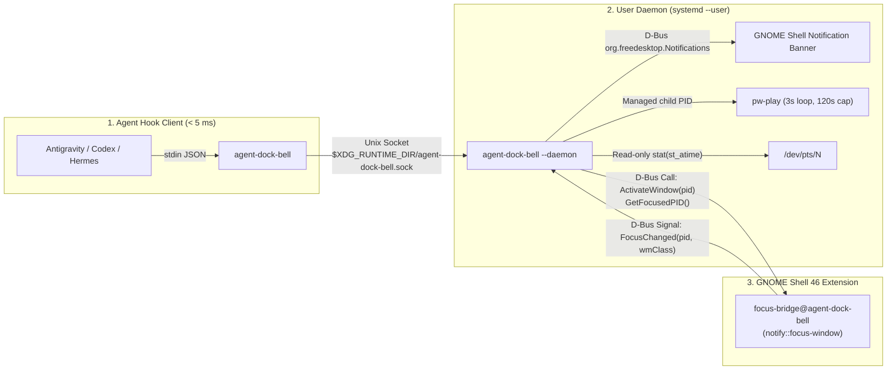

# `agent-dock-bell` v2 — System Architecture

## 1. High-Level Overview

`agent-dock-bell` v2 uses a decoupled **Single-Binary Go CLI + Persistent User Daemon + GNOME Shell 46 Focus Bridge Extension** architecture designed to have **0% idle CPU usage** and **< 0.5% active overhead**.

---

## 2. Components

### 2.1 Hook Client (`cmd/agent-dock-bell`)
- Invoked synchronously by agent lifecycle hooks (`Stop`, `on_session_end`).
- Reads stdin up to `10 MB` with a bounded non-blocking timeout (`200 ms`).
- Parses structured JSON (`internal/hook`) to filter out intermediate tool calls (`tool_use`) and background subagents.
- Inspects `/proc` ancestor chain (`internal/procinfo`) in `< 1 ms` to discover:
  - `TerminalPID`: ancestor terminal emulator or IDE process ID (`gnome-terminal-server`, `ptyxis`, `kitty`, `alacritty`, `wezterm`, `ghostty`, `code`, `cursor`, etc.).
  - `TTYPath`: controlling slave PTS (`/dev/pts/N`).
- Sends a compact JSON request over `$XDG_RUNTIME_DIR/agent-dock-bell.sock` with a `30 ms` deadline, prints `{}` to stdout, and exits `0`.

### 2.2 Background Daemon (`agent-dock-bell --daemon`)
- Managed by `systemd --user` (`agent-dock-bell.service`) with hard kernel guardrails (`CPUQuota=1%`, `MemoryMax=25M`).
- Also supports on-demand auto-start if the socket is not yet listening.
- Maintains a single active alarm state machine (`internal/daemon`):
  - Queries `org.agentdockbell.FocusBridge.GetFocusedPID` over session D-Bus.
  - **Already focused**: spawns a single detached chime (`pw-play`) and suppresses visual banners.
  - **Unfocused**:
    1. Calls `org.freedesktop.Notifications.Notify` (with `replaces_id` to update in-place without stacking banners and `"default"` action for click-to-focus).
    2. Starts `AudioLoop` (`pw-play` every `3s`, hard timeout `120s`).
    3. Waits on event channels:
       - `FocusChanged(pid, wmClass)` signal matching `TerminalPID` (or a child/parent in the same process tree).
       - `ActionInvoked(nid, "default")` signal -> invokes `FocusBridge.ActivateWindow(TerminalPID)` to raise the terminal window and stops the alarm.
       - `NotificationClosed(nid, reason)` signal when dismissed by the user (`reason == 2`).
       - Lightweight `stat(TTYPath).Atim` check (`250 ms` ticker while alarm is active) or process exit check (`kill(TerminalPID, 0)`).
       - Explicit `stop` command over the Unix socket (`agent-dock-bell --stop`).

### 2.3 GNOME Shell 46 Extension (`gnome-extension/focus-bridge@agent-dock-bell`)
- Pure event-driven GJS extension (~45 lines) subscribing to `global.display.connect('notify::focus-window')`.
- Exposes D-Bus interface `org.agentdockbell.FocusBridge` at `/org/agentdockbell/FocusBridge`:
  - `GetFocusedPID() -> (u pid, s wmClass)`
  - `ActivateWindow(u pid) -> (b activated)`
  - Signal `FocusChanged(u pid, s wmClass)`
- Zero polling, zero accessibility bus (`AT-SPI`) usage, and native Wayland window activation via `metaWindow.activate(global.get_current_time())`.
