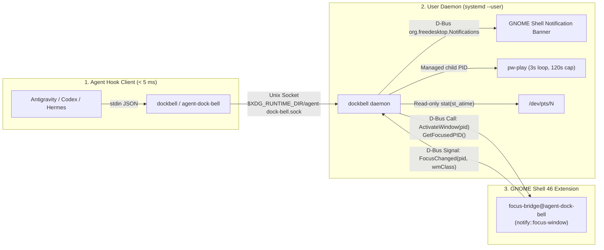

# agent-dock-bell (`dockbell`) 🔔

[](#)
[](#)
[](https://github.com/Rafael-Albernaz-dev/agent-dock-bell/actions/workflows/ci.yml)
[](LICENSE)

An ultra-lightweight, zero-polling desktop alert daemon in **Go + GNOME Shell 46** designed for **AI CLI Agents** (Google Antigravity CLI, OpenAI Codex CLI, Hermes Agent) on Linux.

Built to eliminate multi-project procrastination with **0% idle CPU** and **< 0.5% active OS/terminal overhead**:
1. **Already looking at the terminal?** Plays a single subtle chime (`1x`) and suppresses visual notification popups.
2. **Working in another window?**
   - Displays a native desktop notification (`org.freedesktop.Notifications`) with click-to-focus.
   - Plays a gentle looped chime (`pw-play` every 3s, capped at 120s).
   - **Stops immediately** when you click the notification (which raises/activates your terminal window), focus the terminal window (`Alt+Tab` / click), close the terminal tab, or type in the terminal.

---

## Architecture Highlights



- **Single Static Go Binary (`dockbell` / `agent-dock-bell`)**: Hook invocations complete in **~2–10 ms** over a Unix domain socket (`$XDG_RUNTIME_DIR/agent-dock-bell.sock`) and never block agent execution.
- **Zero GNOME Terminal Interference**: Zero AT-SPI accessibility queries, zero X11 polling (`xprop`), and zero open file descriptors or ANSI writes to `/dev/pts/*`.
- **Hard Kernel Resource Guardrails**: Managed by `systemd --user` (`agent-dock-bell.service`) with `CPUQuota=1%`, `MemoryMax=25M`, and `TasksMax=16`.
- **Deterministic Structured Hook Filter**: Parses full stdin JSON payloads up to `10 MB` without fragile raw-text substring heuristics.

See [`ARCHITECTURE.md`](ARCHITECTURE.md) and [`RULES.md`](RULES.md) for full specifications.

---

## Installation & Quick Commands (`dockbell`)

```bash
./install.sh
```

### CLI Commands

```bash
# Check daemon health, audio asset, caller terminal PID/TTY, and FocusBridge status
dockbell status

# Immediately silence any active alarm
dockbell stop

# Inspect systemd service & structured JSON logs
systemctl --user status agent-dock-bell.service
journalctl --user -u agent-dock-bell.service -f
```

---

## Mandatory Quality Gates & Testing

Run the 6-stage quality gate suite (static analysis, forbidden-pattern guardrails, `-race` unit/regression tests, isolated `dbus-run-session` end-to-end integration tests, and `< 25 ms` latency verification):

```bash
./scripts/quality-gate.sh
```
