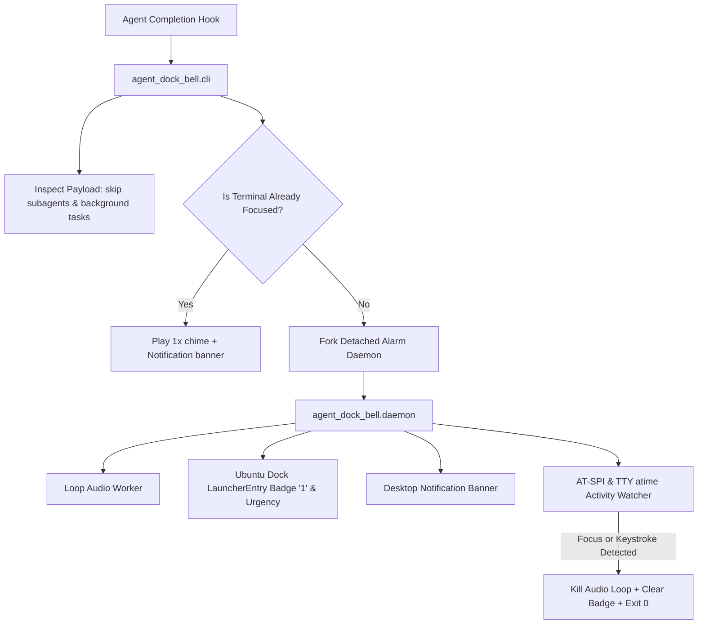

# Architecture Rules, Quality Gates & Testing Standards

This document establishes the architecture contracts, quality gates, and anti-gaming testing standards for `agent-dock-bell`. All contributors and autonomous agents modifying this codebase must adhere strictly to these rules.

---

## 1. Core Architecture & System Contracts

`agent-dock-bell` bridges AI coding agents (Antigravity CLI, Codex CLI, Hermes, etc.) with the Linux desktop environment (GNOME / Ubuntu on Wayland & X11).



---

## 2. Audio Subsystem Rules

1. **Self-Contained Bundled Assets**:
   - The primary notification sound MUST be bundled inside `assets/` in the repository (`assets/universfield-new-notification-02-323592.mp3`).
   - Code must NEVER assume files exist only in volatile user directories like `~/Downloads` or temporary media mounts.
2. **Resolution Hierarchy**:
   `resolve_sound_file()` must resolve candidates in strictly defined priority:
   1. `AGENT_ALARM_SOUND` environment variable (preset name or valid file path).
   2. Bundled repository asset (`assets/universfield-new-notification-02-323592.mp3`).
   3. User local audio directory (`~/.local/share/sounds/universfield-new-notification-02-323592.mp3`).
   4. Secondary media mount / Downloads fallback.
   5. System presets (`bell`, `complete`, `pop`, `click`) as last-resort fallback.
3. **No Dual Bells**:
   - Do not trigger `\a` (ASCII BEL) on terminals playing custom audio files. Custom PipeWire audio must be clean and unpolluted.

---

## 3. Desktop Notification Rules

1. **Global Banner Visibility**:
   - Desktop notifications sent via `notify-send` MUST display as a prominent top banner on GNOME Shell.
   - Do NOT pass `string:desktop-entry:...` in `notify-send` hints, as GNOME Shell suppresses banners for running desktop applications when this hint is present.
   - Always supply `-u normal` (or `-u critical`), `-t 5000`, and `-h boolean:suppress-sound:true` to prevent GNOME from playing its default system chime over the alarm chime.
2. **Icon Fallback**:
   - Use `"utilities-terminal"` as a guaranteed fallback icon to ensure clean rendering on systems where application-specific icons are not installed in the icon theme.
3. **Notification Broker Safety**:
   - Any background broker socket must cleanly close client sockets in a `finally` block to prevent descriptor leaks.
   - Never leave pseudo-terminal titles clobbered with UUID markers. Original titles must always be restored.
   - If broker registration fails or is bypassed (`AGENT_DIRECT_NOTIFICATION=1`), standard `notify-send` must execute immediately without delay.

---

## 4. Focus & Activity Detection Rules

1. **TTY Activity Detection**:
   - Pseudo-terminals (`/dev/pts/*`) update `st_mtime` whenever a process writes to stdout/stderr.
   - Because agents and shell prompts write output immediately after hook invocation, checking `st_mtime` causes false-positive activity detection and premature alarm termination.
   - TTY activity monitoring MUST evaluate `st_atime` (access time / read operations = user keystrokes), NEVER `st_mtime` alone.
2. **Wayland & AT-SPI**:
   - Window focus detection on Wayland must inspect AT-SPI `Role.FRAME` and `Role.WINDOW` states for `StateType.ACTIVE` and `StateType.FOCUSED`.
   - Do not assume AT-SPI `grab_focus()` can raise unactivated windows on Wayland; window manager focus stealing is blocked by Mutter/Wayland by design.

---

## 5. Anti-Gaming Testing Policy

> [!CAUTION]
> **No Mock Gaming Allowed.**
> Mocking away the exact behavior under test is strictly prohibited. All test suites must verify real behavior, real paths, and real contracts.

1. **Three-Tier Test Architecture**:
   - **Unit Tests** (`tests/test_*.py`): Component-level tests verifying internal logic.
   - **Regression Tests** (`tests/test_regression.py`): Explicit guards against all historical bugs (sound fallback, TTY mtime false triggers, subagent filtering, socket leaks).
   - **Integration Tests** (`tests/test_integration.py`): Real end-to-end subprocess runs verifying actual CLI behavior (`--test`, `--stop`, `--dry-run`), real file headers, and real binary execution.
2. **No Broken Imports**:
   - Tests must not import external libraries at module top-level if they are not declared dependencies or if they break standard test runners.

---

## 6. Mandatory Quality Gates

Before any change is committed or released, all 5 automated Quality Gates must pass:

```bash
./scripts/quality-gate.sh
```

| Gate | Check | Criteria |
|---|---|---|
| **Gate 1** | Syntax & Compilation | `python3 -m compileall -q src tests` with zero errors. |
| **Gate 2** | Asset Integrity | Bundled MP3 exists, readable, and size > 10KB. |
| **Gate 3** | Automated Test Suite | Unit, regression, and integration tests pass cleanly (70/70+). |
| **Gate 4** | Runtime Diagnostics | `agent-dock-bell --test` outputs `(found)` and `All systems operational`. |
| **Gate 5** | Lifecycle Shutdown | `agent-dock-bell --stop` terminates alarms and outputs `Stopped active alarms`. |
